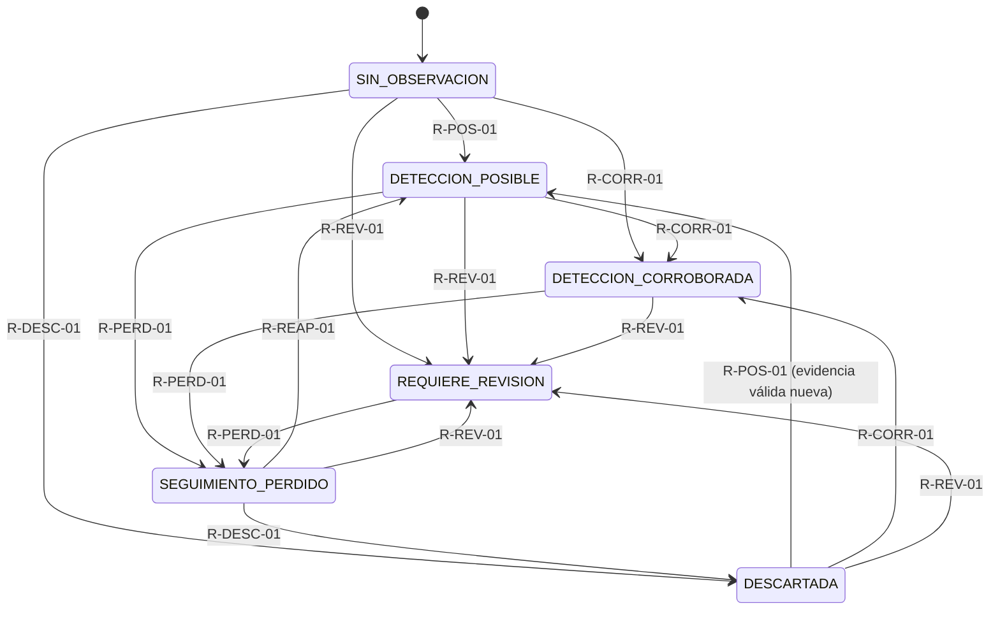

# Motor de fusión y decisiones (O3)

Versión del motor: `o3-motor-decisiones-1.0.0` (`ENGINE_VERSION`).
Código: `src/decision_agents/`, `src/correlation/`, `src/tracking/`, `src/audit/`.

El motor es **determinista** (sin modelos de lenguaje, sin aleatoriedad, sin reloj de
pared: `now_utc` siempre se inyecta) y **conservador**: ante la duda no asocia, y prefiere
`REQUIERE_REVISION` o `DETECCION_POSIBLE` antes que una corroboración falsa.

## Flujo de `OperationalPipeline.process_batch(observations, now_utc, station_status)`

1. Ordena el lote: primero las observaciones con `object_id`, luego las anónimas; dentro
   de cada grupo por `(timestamp_utc, station_id, sensor_type, event_id)`. El resultado no
   depende del orden de llegada, y una detección anónima del mismo lote puede asociarse
   al track identificado en lugar de abrir uno aparte.
2. `agent_correlator` descarta duplicados (`event_id` ya visto, o contenido equivalente).
3. `agent_quality` evalúa estación, antigüedad, futuro y calidad mínima.
4. `agent_correlator` asocia la observación a un track existente o crea uno nuevo.
5. `agent_tracker` la incorpora (puntos con incertidumbre, contradicciones, reaparición).
6. `agent_tracker` marca pérdidas por caducidad respecto a `now_utc`.
7. `agent_evidence` resume la evidencia y `state_engine` aplica la tabla de reglas.
8. `agent_alerts` genera alertas informativas.
9. `agent_audit` registra cada paso (`AuditEvent`, exportable a JSONL).

IDs deterministas: `track_id = TRK-[SIM-]<sha256(primer event_id)>`,
`decision_id = DEC-<sha256(track, estados, regla, now, evidencia)>`,
`alert_id = ALR-<sha256(decision_id)>`, `audit_id = AUD-<sha256(secuencia, ...)>`.

## Tabla de reglas

Se evalúan en este orden de prioridad; la primera que se cumple propone el estado. Si
coincide con el actual no hay decisión; si la transición no está permitida se ignora y se
audita (`transicion_no_permitida`).

| Prioridad | `rule_id` | Estado destino | Condición |
|---|---|---|---|
| 1 | `R-PERD-01` | `SEGUIMIENTO_PERDIDO` | Sin observaciones más allá de `lost_timeout_s` (no aplica a `DESCARTADA`). |
| 2 | `R-REV-01` | `REQUIERE_REVISION` | Posiciones incompatibles del MISMO `object_id` en la ventana (segmento actual). |
| 3 | `R-REAP-01` | `DETECCION_POSIBLE` | Track perdido que recibe evidencia válida reciente (reaparición). |
| 4 | `R-DESC-01` | `DESCARTADA` | Toda la evidencia tiene `classifier_score < min_classifier_score` y no hay otra válida. |
| 5 | `R-CORR-01` | `DETECCION_CORROBORADA` | Dos observaciones técnicamente independientes y consistentes dentro de `corroboration_window_s`, ambas con calidad `>= min_corroboration_quality`. |
| 6 | `R-POS-01` | `DETECCION_POSIBLE` | Al menos una observación válida. |
| — | `R-HUM-01` | `POSIBLE`/`CORROBORADA`/`REQUIERE_REVISION`/`DESCARTADA` | Revisión humana explícita (`OperationalPipeline.apply_human_review`). |

Cada cambio produce un `DecisionRecord` con `rule_id`, `reason` en español,
`evidence_event_ids`, `previous_state`, `requires_human_review` (verdadero para
`REQUIERE_REVISION`, `DETECCION_CORROBORADA`, `SEGUIMIENTO_PERDIDO`, y para
`DETECCION_POSIBLE` si `alert_on_posible`), `engine_version` e `is_simulated`.

**Segmento de evidencia.** Las reglas solo miran la evidencia desde el inicio del
segmento actual: la creación del track, la última reaparición o la última revisión
humana. Así, tras una pérdida la corroboración debe volver a establecerse con evidencia
nueva, y una revisión humana no se revierte sola sin evidencia posterior.

## Diagrama de estados

No hay rebajas automáticas: `DETECCION_CORROBORADA` no vuelve a `DETECCION_POSIBLE`, y
`REQUIERE_REVISION` solo sale por pérdida o por revisión humana (`R-HUM-01`, que puede
llevar desde cualquier estado a los cuatro destinos indicados en la tabla).

## Criterio de independencia técnica

Dos observaciones del mismo track son **independientes** si:

- modo `sensor_type` (por defecto): tienen distinto `sensor_type` y el par no está en
  `non_independent_sensor_pairs`;
- modo `sensor_type_or_station`: además cuenta el mismo tipo en distinta estación,
  **excepto** `remote_id`.

Dos recepciones de Remote ID (aunque sea en estaciones distintas) **nunca** son
independientes: son la misma autodeclaración del dron. Por la misma razón, al fusionar
puntos, contribuciones del mismo tipo con idéntica posición en el mismo instante se
cuentan una sola vez y no reducen la incertidumbre.

Si en un despliegue el detector `rf` solo recibe la propia baliza Remote ID, debe
configurarse `non_independent_sensor_pairs=[("remote_id", "rf")]`.

**Consistencia**: ambas dentro de `corroboration_window_s`; si ambas tienen posición,
distancia `<= min(max_association_distance_m, k·sqrt(σ1²+σ2²) + v_max·|dt|)`. Una
observación sin posición solo puede estar en un track con posiciones si comparte
`object_id`, que es entonces la base de su consistencia.

## Correlación y deduplicación

- **Duplicado por `event_id`** (en el lote o en lotes previos, dentro de
  `dedup_retention_s`) y **por contenido equivalente**: misma estación, tipo de sensor,
  `object_id`, instante exacto, posición (lat/lon a `position_round_decimals`) y altitud.
- **Asociación** (nunca entre simulado y no simulado):
  1. con `object_id`: solo al track con el mismo `object_id` (incluido uno perdido →
     reaparición); si no existe, track nuevo;
  2. sin `object_id` y con posición (radar, óptico): candidatos = tracks activos con
     posición cuyo punto más cercano en el tiempo esté a `|dt| <= association_max_gap_s`
     y a distancia `d <= puerta = min(max_association_distance_m, k·sqrt(σ_obs²+σ_pt²) +
     v_max·|dt|)`, excluyendo los que ya tienen una observación de la misma estación y
     tipo de sensor en el mismo instante (un sensor no reporta dos veces el mismo objeto
     a la vez). Regla determinista:
     - 0 candidatos → track nuevo;
     - 1 candidato → se asocia;
     - varios → se ordenan por `z = d/puerta` (empate: `track_id`); se asocia al mejor
       solo si `z1 < ambiguity_ratio · z2` (claramente mejor). Si no, la observación se
       acepta (va en `accepted`) pero **queda sin asociar**: ni elección arbitraria ni
       track nuevo. Se audita como `observacion_no_asociada`.
  3. sin `object_id` y sin posición (acústica, RF): **track de presencia** único por
     `(estación, tipo de sensor, procedencia)`. Agrupa todas las ráfagas de ese detector
     (incluidas detecciones simultáneas: el detector no distingue fuentes) y nunca se
     asocia espacialmente ni a tracks con posición; `points` siempre vacío. Si caduca y
     vuelven a llegar observaciones recientes, se reabre el mismo track (`R-REAP-01`).
     Un track de presencia no puede corroborarse con otra fuente (todas sus
     observaciones son del mismo detector), salvo `independence_mode` explícito.
- **Contradicción**: observación con el mismo `object_id` a más de
  `max(contradiction_distance_m, k·σ_comb + v_max·|dt|)` del punto del track más cercano
  en el tiempo (dentro de la ventana). Se guarda como evidencia, no entra en la
  trayectoria y dispara `R-REV-01`.

### Cruces de objetos anónimos (comportamiento documentado)

Sin estimación de velocidad, cuando dos objetos anónimos se cruzan sus observaciones
quedan equidistantes de ambos tracks: se dejan **sin asociar** mientras la ambigüedad
persista. Si dura más de `association_max_gap_s`, los tracks originales dejan de ser
candidatos y se abren tracks nuevos. Resultado: puede haber más tracks que objetos
(prueba con 2 objetos: 4 tracks), pero **ningún track mezcla detecciones de dos objetos**.
Dos observaciones idénticas (misma estación, instante y posición) se tratan como
duplicado de contenido.

### Regresión corregida: fragmentación (escenario `basico`, seed 42)

Antes, 3 drones producían 294 tracks (270 de radar de un solo punto). Causas: (1) una
observación ambigua creaba un track nuevo, que a su vez aumentaba la ambigüedad del paso
siguiente (cascada); (2) la puerta solo consideraba puntos dentro de
`correlation_window_s` (10 s), así que detecciones fallidas rompían la cadena; (3) las
ráfagas acústicas separadas más de 10 s abrían tracks nuevos. Ahora: 11 tracks (2 con
Remote ID, 1 radar+óptico del dron sin Remote ID, 3 de radar con 1–2 puntos por
detecciones fuera de la puerta 3σ, 5 de presencia acústica/RF).

## Calidad (`agent_quality`)

Calidad efectiva = (`sensor_quality` o `default_sensor_quality`) × (`degraded_quality_factor`
si la estación está `degraded`). Rechazos (van a `PipelineResult.rejected` con
`stage="validation"`): `STATION_OFFLINE`, `STALE`, `FUTURE_TIMESTAMP`, `LOW_QUALITY`.
El último `station_status` recibido se recuerda entre lotes.

## Parámetros (`PipelineConfig`) y valores por defecto

| Parámetro | Defecto | Significado |
|---|---|---|
| `correlation_window_s` | 10.0 s | Ventana para comparar posiciones del mismo `object_id` (contradicciones) |
| `max_association_distance_m` | 300 m | Tope de la puerta espacial (obs. sin `object_id`) |
| `association_max_gap_s` | 30 s | Hueco máximo entre observación anónima y el punto del track candidato |
| `ambiguity_ratio` | 0.5 | Con varios candidatos, el mejor debe tener `z < 0.5·z_segundo` |
| `association_sigma_factor` | 3.0 | k en `k·sqrt(σ1²+σ2²)` |
| `default_uncertainty_m` | 30 m | σ supuesta si falta `measurement_uncertainty` |
| `max_speed_mps` | 30 m/s | Ensancha las puertas con `v_max·|dt|` |
| `contradiction_distance_m` | 500 m | Distancia mínima para declarar incompatibilidad |
| `lost_timeout_s` | 30 s | Caducidad → `SEGUIMIENTO_PERDIDO` |
| `corroboration_window_s` | 5 s | Diferencia temporal máxima entre fuentes independientes |
| `independence_mode` | `sensor_type` | Criterio de independencia |
| `non_independent_sensor_pairs` | `[]` | Pares de tipos no independientes |
| `min_corroboration_quality` | 0.5 | Calidad mínima para contar en una corroboración |
| `max_observation_age_s` | 120 s | Antigüedad máxima (`STALE`) |
| `max_future_s` | 5 s | Tolerancia a timestamps futuros |
| `min_quality` | 0.2 | Calidad mínima para aceptar como evidencia |
| `default_sensor_quality` | 0.7 | Calidad supuesta si falta `sensor_quality` |
| `degraded_quality_factor` | 0.5 | Factor por estación degradada |
| `min_classifier_score` | 0.3 | Por debajo no es evidencia válida (base de `R-DESC-01`) |
| `alert_on_posible` | `False` | Alertar también `DETECCION_POSIBLE` |
| `alert_lost_only_if_alerted` | `True` | La pérdida solo alerta si el track ya había alertado |
| `alert_cooldown_s` | 300 s | No repetir la alerta del mismo estado y track antes de este tiempo |
| `dedup_retention_s` | 3600 s | Memoria de deduplicación |
| `position_round_decimals` | 7 | Redondeo de lat/lon en la clave de contenido |

Son parámetros de software para la simulación; no describen el alcance ni la precisión
de ningún equipo real.

## Seguimiento

- Solo observaciones con posición generan puntos (`TrackPoint`). Acústica y RF sin
  posición actualizan `last_seen_utc` y aportan evidencia, pero un objeto solo acústico
  tiene `points == []`.
- Suavizado simple: observaciones del mismo instante se fusionan con media ponderada por
  `1/σ²`; `uncertainty_m = sqrt(1/Σ(1/σ²))`. Altitud: la de la contribución de menor σ.
- Distancias con haversine (radio medio terrestre).
- Observaciones desordenadas: los puntos se ordenan por tiempo; una observación tardía
  (más vieja que `lost_timeout_s`) no reabre un track perdido.

## Alertas

Solo `severity="informativa"` y `requires_human_review=True`. Estados que alertan:
`REQUIERE_REVISION`, `DETECCION_CORROBORADA`, `SEGUIMIENTO_PERDIDO` (y `DETECCION_POSIBLE`
si `alert_on_posible`). El mensaje describe la evidencia (fuentes, cantidad, intervalo) y
pide revisión humana; lleva el prefijo `[SIMULADO]` si los datos son simulados. Los tests
verifican que no contiene vocabulario de amenaza, hostilidad ni acciones.

Proporcionalidad: solo hay alerta en un **cambio** de estado (nunca por reconfirmar el
mismo estado); no se repite la alerta del mismo estado para el mismo track antes de
`alert_cooldown_s`; y `SEGUIMIENTO_PERDIDO` solo alerta si el track ya había generado
alguna alerta (una detección aislada posible que caduca no alerta). Toda supresión queda
auditada (`alerta_suprimida`) y la decisión se registra igualmente.

## Límites

- **No clasifica amenazas** ni hostilidad, no puntúa riesgo de personas, no recomienda
  ni ordena acciones, no deduce identidades. `DETECCION_CORROBORADA` significa solo que
  dos fuentes técnicamente independientes son consistentes entre sí.
- **El audio no da posición** (el contrato lo impide y el tracker no crea puntos sin
  coordenadas). **El RSSI solo no da posición**: una observación RF sin coordenadas no
  crea puntos.
- Remote ID es una **autodeclaración**: se trata como una sola fuente, aunque la reciban
  varias estaciones.
- **La simulación no demuestra alcance**: las pruebas con distancias de 100 m a 10 km
  verifican el software, no la capacidad de ningún sensor real.
- La asociación espacial sin `object_id` es deliberadamente estricta: detecciones fuera
  de la puerta 3σ o cruces ambiguos pueden crear tracks adicionales para un mismo objeto
  (preferible a fusionar objetos distintos). No hay filtro de movimiento (Kalman).
- Un track de presencia (audio/RF sin posición) indica que un detector reporta actividad,
  no cuántos objetos hay ni dónde están.
